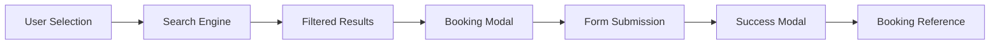

# AuraVoyage | Bespoke Luxury Travel Platform

AuraVoyage is a premier luxury travel booking platform that redefines global mobility through four sovereign disciplines: diplomatic visa facilitation, private aviation, five-star hotel accommodations, and exotic supercar rentals.

---

## 🌟 Overview

AuraVoyage delivers a seamless, end-to-end travel experience for discerning clients who demand the highest standards of privacy, exclusivity, and service excellence. The platform integrates visa services, flight bookings, hotel reservations, and car rentals into a unified, premium experience.

---

## 🛠 Tech Stack

| Category | Technology |
|----------|------------|
| **Framework** | Next.js 16.4.4 (App Router) |
| **Styling** | Tailwind CSS 4 + Custom CSS |
| **UI Components** | Shadcn UI + Radix UI |
| **Animation** | GSAP (GreenSock Animation Platform) |
| **Icons** | Lucide React |
| **Form Handling** | React 19.3.0 |
| **Notifications** | Sonner |
| **Deployment** | Vercel |

### Key Dependencies

```json
{
  "next": "16.4.4",
  "react": "19.3.0",
  "gsap": "^3.15.0",
  "@gsap/react": "^2.1.2",
  "lucide-react": "^1.66.0",
  "sonner": "^2.0.8",
  "shadcn": "^4.23.0",
  "radix-ui": "^1.8.1"
}
```

---

## 🏗️ Project Structure

```
e:\Travel Agency Website\
├── app/
│   ├── layout.tsx          # Root layout with font optimization
│   ├── page.tsx            # Main landing page
│   └── globals.css         # Global Tailwind styles
├── assets/                 # Static assets (background images)
├── components/
│   ├── search-engine/      # Interactive booking search system
│   │   ├── index.tsx       # Main search engine component
│   │   ├── SearchModal.tsx # Airport search modal
│   │   ├── SearchTabs.tsx  # Tab navigation (flights/hotels/cars/visas)
│   │   ├── FlightSearchForm.tsx
│   │   ├── HotelSearchForm.tsx
│   │   ├── CarSearchForm.tsx
│   │   ├── VisaSearchForm.tsx
│   │   ├── BookingModal.tsx # Booking confirmation modal
│   │   └── FormField.tsx   # Shared form components
│   ├── ui/                 # Reusable UI components
│   │   ├── button.tsx
│   │   └── sonner.tsx
│   ├── Navbar.tsx          # Sticky navigation with mobile menu
│   ├── Hero.tsx            # Hero section with search CTA
│   ├── ServicesSection.tsx # Four service pillars showcase
│   ├── DestinationsSection.tsx # Destination gallery with filters
│   ├── PackagesSection.tsx # Pre-curated travel packages
│   ├── WhyChooseUs.tsx     # Key differentiators
│   ├── TestimonialsSection.tsx # Client reviews carousel
│   ├── FaqSection.tsx      # FAQ accordion
│   ├── ContactSection.tsx  # Bespoke inquiry form
│   ├── Footer.tsx          # Footer with links
│   ├── StatsCounter.tsx    # Live statistics counter
│   └── ScrollToTop.tsx     # Smooth scroll to top
├── lib/
│   ├── mock-data.ts        # Mock data for all sections
│   └── utils.ts            # Utility functions
├── public/                 # Static assets
├── .next/                  # Next.js build output
├── package.json
└── next.config.ts
```

---

## ✨ Features

### 1. **Diplomatic Visa Facilitation**
- 99.4% approval rate guarantee
- 24-48h fast-track processing for Schengen, US, UK visas
- In-house consular legal team
- Mock interview preparation
- Zero-refusal insurance

### 2. **Private Aviation & First Class**
- Consortium access to 12 global flagships
- Private jet charters (Bombardier Global 7500)
- Lie-flat first-class suites on Emirates, Singapore Airlines, Air France
- Tarmac chauffeur transfers
- Custom Michelin-star dining

### 3. **Five-Star Palaces & Sanctuaries**
- 3,200+ Virtuoso & Four Seasons partner properties
- Automatic room upgrades
- $100-$200 resort credits
- Early check-in & late check-out guarantees
- Dedicated butler service

### 4. **Exotic Supercars & Executive Fleet**
- Ferrari, Porsche, Range Rover, Mercedes-Maybach
- Zero-deductible insurance
- Curbside delivery to tarmac/villa/yacht
- Uniformed multilingual chauffeurs
- Unlimited mileage packages

### 5. **Search & Booking Engine**
- Multi-tab search (Flights, Hotels, Cars, Visas)
- Real-time availability filtering
- Flexible dates with price comparison
- Responsive booking modal with form validation
- Booking confirmation with reference numbers

### 6. **Destinations Gallery**
- Filterable destination cards (Beaches, Europe, Alpine, Middle East, Asia)
- Pre-curated travel packages
- Four-pillar itineraries (visa, flight, hotel, car)
- Price ranges and duration filters

### 7. **Client Testimonials**
- Auto-playing review carousel
- Service-specific filtering
- Verified client feedback
- Star rating display

### 8. **FAQ & Support**
- Interactive accordion FAQ
- Live chat support access
- 24/7 dedicated travel director
- Diplomatic protocol assistance

### 9. **Bespoke Inquiry Form**
- Service selection dropdown
- Budget range selector
- Contact information capture
- Custom notes field
- Submission confirmation with toast notifications

---

## 🎨 Design System

### Color Palette
- **Primary:** `#0F1E36` (Deep Navy)
- **Accent Gold:** `#C5A059` / `#9E7D3B`
- **Light Background:** `#FAF8F5` / `#FFF9F1`
- **Secondary:** `#E8E2D5` (Soft Beige)

### Typography
- **Serif:** Playfair Display (Headings)
- **Sans:** Plus Jakarta Sans (Body text)

### Animations
- GSAP-powered hero content fade-ins
- Hover scale effects on cards
- Smooth scroll navigation
- Modal zoom-in transitions
- Auto-playing testimonials carousel

---

## 🚀 Getting Started

### Prerequisites
- Node.js 18+ 
- npm or yarn

### Installation

```bash
# Clone the repository
git clone <repository-url>
cd <project-folder>

# Install dependencies
npm install

# Start development server
npm run dev
```

### Available Scripts

| Command | Description |
|---------|-------------|
| `npm run dev` | Start development server at `localhost:3000` |
| `npm run build` | Create production build in `.next` folder |
| `npm start` | Run production server |
| `npm run lint` | Run ESLint |

---

## 📱 Responsive Breakpoints

| Device | Breakpoint | Layout |
|--------|------------|--------|
| Mobile | < 640px | Single column |
| Tablet | 640px - 1024px | 2-column grid |
| Desktop | 1024px - 1440px | 3-column grid |
| Large | > 1440px | Max-width container |

---

## 🎯 Key Components

### Navbar (`components/Navbar.tsx`)
- Sticky header on scroll
- Mobile hamburger menu
- Quick phone dialer
- Navigation scroll-to-section
- Logo hover animation (GSAP)

### Hero (`components/Hero.tsx`)
- Full-screen background image
- GSAP animations for text content
- Search engine CTA button
- Mobile-optimized text overlay

### Booking Modal (`components/search-engine/BookingModal.tsx`)
- Modal portal rendering
- Form validation
- Success confirmation
- State reset on new booking

### Search Engine (`components/search-engine/index.tsx`)
- Tab switching (flights/hotels/cars/visas)
- Form filters
- Results grid
- "Show More" functionality

---

## 🔄 Data Flow



---

## 🔐 Security Features
- Form validation on client side
- Email format validation
- Required field checks
- Toast error notifications
- Secure form data handling

---

## 🌍 Multi-Language Ready
- English interface
- ISO country codes
- Unicode support for international characters

---

## 📦 Deployment

### Vercel (Recommended)
```bash
vercel --prod
```

### Manual Deployment
1. Run `npm run build`
2. Copy `.next` folder to server
3. Run `npm start`

---

## 🐛 Known Issues & Fixes

### Hydration Mismatch
- **Cause:** Browser extensions adding attributes to `<body>` tag
- **Fix:** Added `suppressHydrationWarning` on `<body>` element

### Booking Modal State
- **Issue:** Form not resetting on new booking
- **Fix:** Added `useEffect` to reset state when `item` changes

---

## 📝 Future Enhancements
- [ ] Backend API integration
- [ ] Real-time inventory updates
- [ ] Payment gateway integration
- [ ] User account system
- [ ] Itinerary download (PDF)
- [ ] Email notifications
- [ ] Multi-language support

---

## STACK
- Frontend Development: React + Next.js
- Design System: Shadcn UI + Tailwind CSS
- Animations: GSAP
